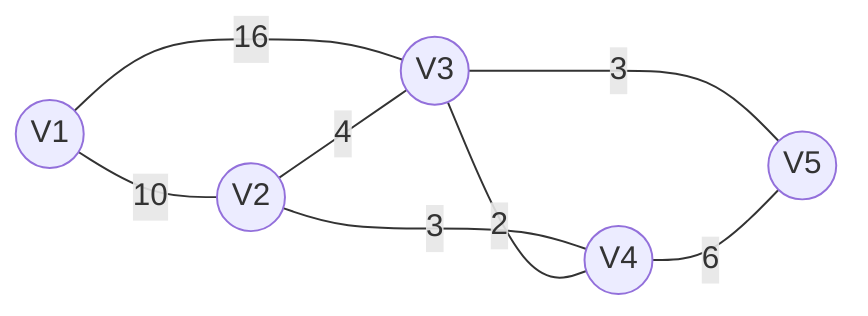

# 🚶‍➡️ ダイクストラ法を理解する 🚶

## 概要

令和6年春期_応用情報技術者試験の午後に出題されたプログラミング問題が解けず、悔しかったので復習する。  
トレースのみではなく、実際にアルゴリズムに則って経路探索を行うことで脳と身体で理解する。

## 実際の出題問題

[出題された問題を見る](doc/exam_pg.pdf)

## 問題のトレース

[src/main.java](src/main.java) を、始点V1から終点V5まで追う。



やることは次の3つの繰り返し。

1. 未確定で一番近いノードを選び、距離を確定する
2. 選んだノードが終点なら終了する
3. 選んだノードを経由した方が近いノードの距離を更新する

| 回 | 確定するノード | 更新 | V1 | V2 | V3 | V4 | V5 |
| ---: | --- | --- | ---: | ---: | ---: | ---: | ---: |
| 1 | V1(0) | V2=10、V3=16 | **0** | 10 | 16 | - | - |
| 2 | V2(10) | V3=14、V4=13 | **0** | **10** | 14 | 13 | - |
| 3 | V4(13) | V5=19 | **0** | **10** | 14 | **13** | 19 |
| 4 | V3(14) | V5=17 | **0** | **10** | **14** | **13** | 17 |
| 5 | V5(17) | 終了 | **0** | **10** | **14** | **13** | **17** |

太字は確定した距離、`-` は未到達を表す。

最後に、各ノードの直前に通ったノードを終点から逆にたどる。

```text
V5 ← V3 ← V2 ← V1
```

実行結果は次のとおり。コードの `0`〜`4` は `V1`〜`V5` に対応する。

```text
最短経路：4 ← 2 ← 1 ← 0
最短距離：17
```

## 実際に探索してみた

TODO：良い感じの経路探し中

## まとめ

TODO